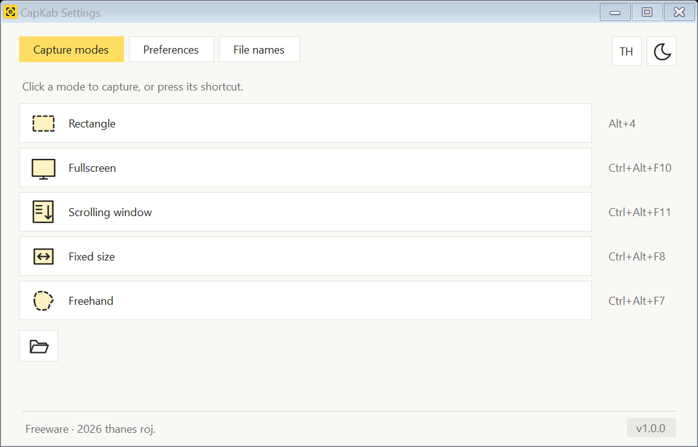

# CapKab

A light, free screenshot tool for Windows with Thai and English interface. No account, no ads, no network access, no expiry. Free for personal and commercial use.

โปรแกรมแคปหน้าจอ Windows แบบเบา ใช้ฟรี รองรับภาษาไทยและอังกฤษ ไม่ต้องสมัครสมาชิก ไม่เชื่อมต่ออินเทอร์เน็ต



## Features

- Five capture modes: rectangle, fullscreen, scrolling window, fixed size and freehand
- Shutter sound on every capture, so you know it worked (can be switched off in Preferences)
- No visual effects during capture: no dimming, flash or fade
- Runs from the tray; about 30 MB private memory and no CPU when idle
- Thai / English interface, light and dark colours, file naming options

## Install

Download `CapKab-Setup.exe` from the [Releases](../../releases) page and run it. The program installs for the current user only (no administrator rights needed) in `%LOCALAPPDATA%\CapKab`.

Windows 11 with **Smart App Control** turned on blocks programs that are not code-signed. CapKab is not signed yet. Either turn Smart App Control off, or build the program yourself from this source (see below).

## Build from source

You need 64-bit Windows 10/11 with .NET Framework 4.8. No other package is needed; the build uses the C# compiler that ships with Windows.

```powershell
.\Build.ps1
```

This produces `outputs\CapKab-Setup.exe` and `work\CapKab.exe`. The build runs a real screen-capture self-test, so run it in a logged-in desktop session, not in a headless CI job.

Run the UI test suite after changes:

```powershell
.\work\TestUi.ps1
```

It opens windows, takes temporary screenshots and plays the shutter sound several times. All settings it touches are redirected to `HKCU\Software\CapKab.UiTest` and removed afterwards.

## Source layout

| File | Purpose |
| --- | --- |
| `work/Capture.cs` | The application: UI, settings, hotkeys, capture, saving, uninstall |
| `work/Setup.cs` | The installer |
| `work/ProductInfo.cs` | Name, version and owner |
| `work/Assets.cs`, `work/BuildAssets.cs` | Generate the icon and the shutter sound at build time |
| `work/UiTest.cs`, `work/TestUi.ps1` | UI tests |
| `work/PerformanceTest.cs`, `work/UninstallTests.cs` | Speed / memory and uninstall tests |

## Privacy

CapKab does not contain any network code. Screenshots are saved only to the folder you choose; settings are stored under `HKCU\Software\CapKab`.

## License

[MIT](LICENSE), 2026 thanes roj.
